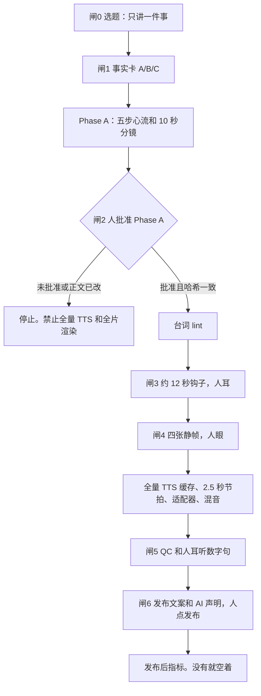

# StoryWeaver

## 关于

StoryWeaver 是闸门制知识短片工作室。它管事实、分镜、人审和 QC，不管「稿子过了就渲全片」。一集按固定工序走：

事实卡 → 五步心流 → Phase A 批准 → 台词 lint → 钩子样片 → 静帧 → 渲染 → QC → 发布 → 指标

没有人批 Phase A，禁止全量配音和全片渲染。画面走共享 Canvas kit，旧 SVG 编译器只留作实验。

系列样品是《看不见的规则》：

- **EP01「电梯为啥不理你」**：闸门样品。证明未批准不能渲成片，不是下一集的稿子。
- **EP02「一条长龙还是三条短队」**：Phase A 已批（横屏 16:9）。正式角色、音频驱动时间轴、无配音预览。

文档站由 `npm run pages` 生成（CI 产物 `pages-site`）。要上线 GitHub Pages，需仓库管理员在 Settings → Pages 把 Source 设为 GitHub Actions；当前 token 无法代开。启用后预期地址：<https://kairos0922.github.io/StoryWeaver/>。

## 快速开始

```bash
npm install
npm test
node studio/cli.mjs layout
node studio/cli.mjs gate series/invisible-rules/ep02 phase-a
```

EP02 应看到 `PHASE_A_APPROVED`。EP01 的 `render` 闸应拒绝（`PHASE_A_REQUIRED`）。

新开一集只填到 Phase A 可以送审，然后停：

```bash
node studio/cli.mjs init-episode series/invisible-rules ep03
```

1. 填 `fact_card.md`。数字只来自 A 区来源或 B 区模拟。
2. 填 `phase_a.md`。一件事、五步、至少一行写满的分镜。横屏不超过 90 秒。
3. `node studio/cli.mjs gate … phase-a` 看到 `PHASE_A_READY_FOR_REVIEW` 就停。审片人自己改 `approved` 并写入哈希。

批准之后：lint → 钩子样片（人耳）→ 四张静帧（人眼）→ 全片 → QC → 人点发布 → 回填 `post/metrics.md`。上一集指标没有来源之前，不要开下一集。

```bash
node studio/cli.mjs lint-script series/invisible-rules/ep02/script.md
node studio/cli.mjs gate series/invisible-rules/ep02 lines
node studio/cli.mjs gate series/invisible-rules/ep02 hook-sample
node studio/cli.mjs gate series/invisible-rules/ep02 stills
node studio/cli.mjs gate series/invisible-rules/ep02 render
node studio/cli.mjs qc series/invisible-rules/ep02
node studio/cli.mjs gate series/invisible-rules/ep02 publish
```

完整闸门：`docs/studio/pipeline.md`。代理步骤：`.cursor/skills/produce-next-episode/SKILL.md`。

## 架构



五步是：钩子 → 打碎常识 → 内幕 → 真相 → 评论站队。

## 目录

```text
series/invisible-rules/     《看不见的规则》。ep01 闸门样品，ep02 Phase A 已批
  ip/                       等等、阿规、嘀嗒
  voice/                    工作室配音合同，不每集重选
studio/
  templates/                事实卡、Phase A、口播、指标
  lint/                     口播脚手架检查
  qc/                       清单。自动项不能手改成通过
  render/kit/               共享 Canvas kit 和音频时间轴
docs/studio/                闸 0–6、Avoid、指标、迁移
src/                        旧 VideoSpec → SVG。不要用来做新的一集
```

## 命令

```bash
node studio/cli.mjs lint-script <script.md|lines.json>
node studio/cli.mjs qc <episode-dir>
node studio/cli.mjs gate <episode-dir> <phase-a|lines|hook-sample|stills|render|publish>
node studio/cli.mjs hash-phase-a <phase_a.md>
node studio/cli.mjs init-episode <series-dir> <epNN>
node studio/cli.mjs layout
npm test
npm run pages
```

退出码：0 通过，或 Phase A 可以送审；1 稿子或清单未完成；2 Phase A 未批准或已过期。

EP01 上预期的结果：

```bash
node studio/cli.mjs lint-script series/invisible-rules/ep01/script.md
# 退出码 1。应看到 meta-plain-speech、scaffold-remember、scaffold-so-dash、oral-ordinal

node studio/cli.mjs gate series/invisible-rules/ep01 render
# 退出码 2。第一行是 PHASE_A_REQUIRED
```

## 旧的 SVG 实验

`src/` 仍能验证和渲染 VideoSpec。CI 继续跑这些测试，避免改目录把旧合同弄坏。

```bash
npm run validate
node src/cli.js render examples/hot-air-balloon.json --out out/hot-air-balloon.mp4
```

这条命令会在标准错误打印 `[legacy]`。系列成片不要从这里开始。
