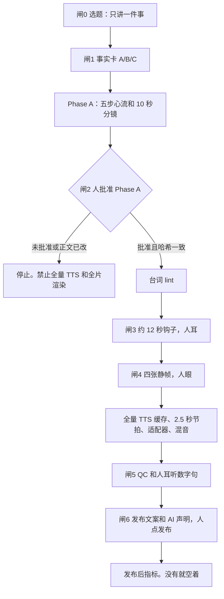

# StoryWeaver

StoryWeaver is a studio for making a series of publishable explainer videos. It keeps the content plan, the fact check, the human gates and the QC. It does not own a physics renderer.

中文工作室：低成本、可重复地做系列知识短片。一集先过事实卡和 Phase A，再谈配音和画面。禁止「稿子过了就渲全片」。

样品是《看不见的规则》第一集「电梯为啥不理你」。样品在 `series/invisible-rules/ep01/`。它用来证明闸门会拦住没有导演提案的成片，不是下一集的稿子。

## 架构



五步是：钩子 → 打碎常识 → 内幕 → 真相 → 评论站队。

画面不从零写。适配器候选是 Manim、HTML Canvas、Remotion、HyperFrames。仓库里原有的 SVG 编译器只留作实验，见 `docs/studio/migration.md`。现在没有选定默认适配器，也没有安装它们。

## 目录

```text
series/invisible-rules/     系列。ep01 是电梯样品
  ip/                       等等、阿规、嘀嗒。精灵图不在仓库里
  voice/                    采用工作室配音合同，不每集重选
  ep01/                     事实卡、历史口播、重建的 Phase A、空的指标
studio/
  templates/                事实卡、Phase A、口播、指标
  lint/                     口播脚手架检查
  qc/                       清单。自动项不能手改成通过
  contracts/                视觉合同、豆包 E3 配音合同
  render/kit/               共享元件名，不是渲染器
  render/adapters/          现成渲染器的合同，含被围起来的旧 SVG
docs/studio/                闸 0–6、Avoid、指标、迁移
.cursor/skills/produce-next-episode/
src/                        旧 VideoSpec → SVG。不要用来做新的一集
```

## 做一集

以 ep02 为例。代理或作者只填到 Phase A 可以送审为止，然后停。

```bash
npm install
node studio/cli.mjs init-episode series/invisible-rules ep02
```

1. 填 `series/invisible-rules/ep02/fact_card.md`。数字只来自 A 区来源或 B 区模拟。没有 `sim/` 结果就不要写秒数。
2. 填 `phase_a.md`。一件事、五步、至少一行写满的分镜。横屏不超过 90 秒，竖屏不超过 60 秒。
3. 检查：

```bash
node studio/cli.mjs gate series/invisible-rules/ep02 phase-a
```

看到 `PHASE_A_READY_FOR_REVIEW` 就停。审片人自己把文首改成 `approved` 并写入 `node studio/cli.mjs hash-phase-a` 的哈希。制作的人不要代填批准。

4. 批准之后写 `script.md`，跑 lint，再过后面的闸。口播规则在 `docs/studio/avoid.md`。

```bash
node studio/cli.mjs lint-script series/invisible-rules/ep02/script.md
node studio/cli.mjs gate series/invisible-rules/ep02 lines
node studio/cli.mjs gate series/invisible-rules/ep02 hook-sample
node studio/cli.mjs gate series/invisible-rules/ep02 stills
node studio/cli.mjs gate series/invisible-rules/ep02 render
node studio/cli.mjs qc series/invisible-rules/ep02
node studio/cli.mjs gate series/invisible-rules/ep02 publish
```

`RENDER_ALLOWED` 之前不要做全片。钩子样片大约 12 秒，人耳听过才进静帧。CLI 本身不调用配音，也不出 MP4。

5. 人点发布。把平台导出抄进 `post/metrics.md`。没有的格子留空。`ep02` 的指标带来源之前，不要开 `ep03`。

完整闸门说明在 `docs/studio/pipeline.md`。代理步骤在 `.cursor/skills/produce-next-episode/SKILL.md`。

## 命令

```bash
node studio/cli.mjs lint-script <script.md|lines.json>
node studio/cli.mjs qc <episode-dir>
node studio/cli.mjs gate <episode-dir> <phase-a|lines|hook-sample|stills|render|publish>
node studio/cli.mjs hash-phase-a <phase_a.md>
node studio/cli.mjs init-episode <series-dir> <epNN>
node studio/cli.mjs layout
npm test
```

退出码：0 通过，或 Phase A 可以送审；1 稿子或清单未完成；2 Phase A 未批准或已过期。

EP01 上预期的结果：

```bash
node studio/cli.mjs lint-script series/invisible-rules/ep01/script.md
# 退出码 1。应看到 meta-plain-speech、scaffold-remember、scaffold-so-dash、oral-ordinal

node studio/cli.mjs gate series/invisible-rules/ep01 render
# 退出码 2。第一行是 PHASE_A_REQUIRED
```

模板口播应当没有错误：

```bash
node studio/cli.mjs lint-script studio/templates/script.md
```

## 旧的 SVG 实验

`src/` 仍能验证和渲染 VideoSpec，例如热气球例子、method proof、production-01。CI 继续跑这些测试，避免这次改目录把旧合同弄坏。

```bash
npm run validate
node src/cli.js render examples/hot-air-balloon.json --out out/hot-air-balloon.mp4
```

这条命令会在标准错误打印 `[legacy]`。系列成片不要从这里开始。
